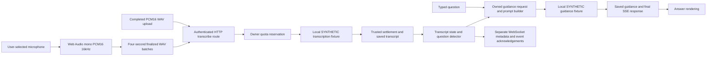

# Kubernetes voice investigation — 31 October 2026

Outcome: the failure is reproduced and its independent causes are verified. The
workspace remains SYNTHETIC. Real speech recognition and a valid AI-generated
Kubernetes answer are BLOCKED by absent authorized live credentials/configuration;
no fixed answer in this report is presented as AI success.

## 1. Repository state

Canonical origin Peter-Agbenyega/Cloud-Nexus-Pilot. Started clean b0210db in the
existing engineering worktree /private/tmp/cnp-quality-gates. Original database,
recovered signing material, saved sessions and original services preserved.
Application patch a3aa61f; bounded-allowance probe extension2440be5. Actual running
patched build: ~/Cloud-Nexus-Pilot-voice-investigation, detached2440be5. Configuration
remains durable/private under ~/.local/share/cloud-nexus-pilot/recovery-test.
Previous runtime checkout is retained. No merge, public deployment or paid call.

## 2. Branch

fix/pilot-voice-provider-diagnosis-20261031. All investigation/source/evidence work
is on this separate branch. Runtime is a separate durable worktree; build never
rewrote the previous running build. Only recovery-stack app/realtime consumers
were reloaded after passing gates, on the same approved loopback ports.

## 3. Active providers

| Provider | Configured | Reachable/authentication | Actually used |
| --- | --- | --- | --- |
| Local OpenAI-compatible SYNTHETIC fixture59093 | Yes; synthetic-transcription / synthetic-guidance | HTTP200; fixture does not implement real vendor authentication; app account auth verified separately | Yes, exact measured call deltas |
| Official OpenAI | Prepared official URL/models, but API key absent | Mac GET /v1/models without any credentials returned401 in225ms; authenticated health/model/quota access UNKNOWN | No |
| Deepgram | DEEPGRAM_API_KEY absent | Not probed, no configured credential | No |
| Azure OpenAI, Google Speech, Gemini, AssemblyAI, local STT/Whisper, Ollama, Anthropic | No configured Pilot adapter/endpoint/credential selected | Not probed; no unrelated service/credential search | No traced use |

The OpenAI adapter name and presence of a local placeholder key never established
that OpenAI handled speech. Before the patch, the capability endpoint incorrectly
said OpenAI even for the known fixture. After: Synthetic fixture for both routes,
speechRecognitionConfigured=false, questionSpecificGuidanceConfigured=false.
These are configuration labels, not an authenticated live-provider health claim.

## 4. Credential status

New local identity/settlement credentials remain bounded and valid. Actual local
Auth/REST calls succeed; no expired settlement failure in this incident. Browser
WebSocket logs separately include an expired user-token closure1008 after an hour,
plus expected300-second idle1001 closures/reconnects. Fresh authenticated WS probe
passes. Those metadata-channel events do not carry raw audio or prove STT failure.

Approved local Pilot sources inspected: current protected pilot.env, prepared
live-provider.env, and app-specific local .env files when present. Current key is
a synthetic placeholder. Both the prior prepared live config and new durable
live config have empty OPENAI_API_KEY. Other provider keys are absent. No production
Vercel secret or unrelated account credential was fetched. Rate limits, model
permissions and paid allowance cannot be certified without a valid authorized key.

Exact prerequisite: securely enter an existing authorized non-production
OPENAI_API_KEY in
/Users/peterchristianagbenyega/.local/share/cloud-nexus-pilot/recovery-test/live-provider.env,
mode0600, and identify existing allowance for one transcription and one answer.
Never paste it in chat. Prepared endpoint is https://api.openai.com/v1; existing
model settings are gpt-4o-mini-transcribe and gpt-4o-mini. Their account access is
unverified. The synthetic launcher intentionally forbids loading an official
provider directly; after key provision, a reviewed explicitly live loopback profile
must replace the fixture endpoint/model selection and be rebuilt before real-mode
claims. Merely hiding the banner or placing a key in the fixture config is not a fix.

Official request contract consulted:
https://developers.openai.com/api/reference/resources/audio/subresources/transcriptions/methods/create
and https://developers.openai.com/api/docs/guides/speech-to-text . No model migration
or live request was performed on the basis of these documents.

## 5. Speech pipeline diagnosis

| Stage | Verified input/output and timing | Failure/limit |
| --- | --- | --- |
| Source/browser capture | Historical fixture158 WAV chunks;149 non-silent;20,016,508 WAV bytes; last4,011ms mono16kHz chunk, peak0.374451/RMS0.066246 | Signal is not proof of spoken words or physical-source provenance. No new mic activated by agent. |
| PCM buffering | DEFAULT_CHUNK_INTERVAL_MS4000 and64,000-frame threshold at16kHz | Chunk transcription, not true streaming STT. Original UI first transcript4180ms is compatible with batch buffering, not evidence of live interim recognition. |
| HTTP transport | Controlled spoken-file chunk202 in82ms; uploaded-file route200 in43ms after patch | These timings exclude capture buffering and use a fixed local responder. |
| Quota | Original account grant20,000,000, consumed19,987,464, reserved0 at first snapshot | Next33,636-byte file rejected429 before dispatch. No stuck reservations. At32,000 bytes/s, grant is roughly625 seconds before guidance overhead, less than30-minute maximum session. |
| Speech provider | Always returns What is infrastructure as code? regardless of audio | No recognition implementation is active. Both physical input and uploaded speech receive fixture text. |
| State/detection | UI detected/saved IaC question; all historical browser transcripts fixed IaC | Raw audio not retained, so original Kubernetes wording cannot be reconstructed from these transcripts. |
| Prompt | Typed Kubernetes question retained in saved association and real prompt/transport contract test | No evidence of prompt losing the typed question. Contract test uses mocked transport, not live AI. |
| Answer provider | Actual typed Kubernetes HTTP request49ms, fixed IaC JSON | Fixture ignores question; no question-specific model call. |
| Response/UI | Native UI saved What is Kubernetes? next to IaC answer | Renderer faithfully displayed wrong fixture content; not an observed dropped-answer fault. |
| WebSocket | auth_required → ready → pong → ended, normal1000 in controlled probe | Metadata only; chunk-save acknowledgement is HTTP202/saved=true, not WS event.ack. |

No original microphone samples or request bodies were retained. Original browser
console/network capture was not available retroactively; native Console attempts
coincided with user window changes, so no original console error is fabricated.
Production Next logs contain startup output rather than the original HTTP payloads.
Controlled requests have explicit paths/status/timings; sanitized WS log metadata
and native browser state observations are separate receipts.

## 6. Transcript evidence by mode

- Physical microphone: user reports asking What is Kubernetes?; historical browser
  processing shows157 successful audio operations and nonzero signal at receiver.
  Physical meter movement and exact audio source were not independently re-observed
  in this turn. Initial native UI showed capture stopped, meter0, disabled Pause
  and no recording title. No new microphone or permission was activated by agent.
- Synthetic tone: prior transport acceptance only, retained as historical evidence.
- Generated speech/upload: macOS TTS produced What is Kubernetes?, mono16kHz PCM16,
  14,770 frames,33,636-byte WAV. Streaming-chunk AND completed-file routes both
  returned the fixed IaC text. This is a reproducible semantic mismatch, not STT
  accuracy success and not physical capture evidence.
- First sandbox TTS run generated zero frames; validator correctly rejected415
  before provider work. Reran local TTS with authorized resource access, verified
  nonzero frames, then repeated trace. No empty file is claimed as speech evidence.

There are157 certified rows plus157 legacy metadata rows in two parent-session
lanes, matching157 charged transcription operations. This is not314 provider calls
or double settlement. Both representations were preserved rather than merged/deleted.

## 7. Kubernetes request trace

See review/kubernetes-investigation/kubernetes-trace-{before,after}.json. Expected
input is known generated speech, not a claim of a human microphone retest.

After patch: spoken-file stream chunk202/saved=true/82ms → fixed IaC transcript;
completed-file route200/43ms → same fixed text; direct typed What is Kubernetes?
→ guidance200/final SSE/49ms → fixed IaC answer. Two transcription calls and one
guidance call measured, one saved stream final, owned read/stop succeeded. WS
metadata authentication/ping/normal shutdown succeeds independently. The exact
original human request timestamp and words cannot be linked retrospectively to a
specific raw packet because raw recordings were never retained.

Native UI typed reproduction independently saved the Kubernetes question alongside
IaC output. Thus bypassing speech recognition does not cure the answer failure.

## 8. Verified root causes

1. Intentional synthetic endpoint/model selection prevents ALL real recognition
   and question-specific AI, including Kubernetes. Missing live key blocks replacement.
2. Bounded local synthetic allowance exhausted during continuous four-second audio
   processing, so later chunks fail429 before provider dispatch. No reservation leak.
3. Capability UI named OpenAI although actual processor was a local fixture.
4. Avg response used session age divided by questions; observed3599s,5289s then2646s
   was not per-request latency. Repeated guidance also overwrote First guidance with
   time since original capture start (observed5,284,293ms for a later typed request).
5. A successful guidance refresh overwrote acknowledgement state while leaving an
   earlier audio quota error, presenting saved and failure together ambiguously.

There is no demonstrated live-provider outage, corrupted Kubernetes prompt, CORS
failure on the approved origin, or missing microphone track in this incident.
Those claims would exceed the evidence.

## 9. Applied changes

- Explicit synthetic provider names, configured-recognition booleans, prominent
  no-recognition/no-question-specific-AI banner and sample-guidance action label.
- Actual completed-request latency averages, no idle-time inflation; first captured
  guidance metric only recorded once; typed follow-ups do not overwrite it; stored
  guidance latency is per-request. Renamed First partial label to First saved
  transcript because this path only acknowledges finalized chunks.
- Earlier processing errors are displayed as processing issues, with saved guidance
  tracked separately; no contradictory saved acknowledgement next to audio error.
- One bounded local QA grant increment20,000,000, total40,000,000; consumed19,988,464
  and reserved0 preserved exactly at update. No quota policy bypass or production
  grant. Actual positive spoken-file probe after update202, one dispatch. All
  accounting and saved sessions preserved.
- Detailed controlled trace/probe scripts, six diagnostics regressions and immutable
  sanitized evidence. Fixed fixture outputs remain unchanged; no canned Kubernetes
  answer was added to misrepresent real AI.

## 10. Test results

PASS: full frontend210 (includes six new diagnostics); four cookie-isolation tests;
lint; TypeScript; production frontend build and realtime compilation. Runtime built
in durable isolated worktree before consumer reload. Prior57 realtime tests remain
historical evidence on unchanged realtime source, not relabeled as a new execution.

PASS diagnostic transport only: authenticated HTTP chunk/upload/save/read/stop,
real local identity/REST/database, WebSocket auth/ping/shutdown, allowance fail-closed
and restored-budget probes. Existing cleanup/retry/security regressions pass as part
of suite; no new physical release/restart pass is claimed.

NOT PASS semantic acceptance: Kubernetes speech transcription and AI answer.
They remain blocked by missing live key and intentionally selected fixed fixture.
Controlled final timings are fixture timings, not a live latency benchmark.

## 11. Remaining issues

Live credentials, model access/remaining allowance, and explicit live test activation
remain missing. Physical microphone accuracy, changing meter and real-provider
latency require a user-spoken check once live configuration is ready. Four-second
batching and final-only validated guidance are not equivalent to a modern continuous
voice assistant. Original database missing global/pg_filenode.map and original saved
session recovery remain separate unresolved work. Production readiness is unverified.

## 12. CLO-7

Existing issue identity/access verified and updated with branch/source/evidence,
all failures/fixes, measured fixture timings, quota preservation, missing key and
separate physical/live/production status. Product status stays In Progress.

## 13. Exact next actions

Owner: securely supply OPENAI_API_KEY in the prepared durable mode0600 live-provider.env
and confirm existing permitted test allowance. No key in chat and no new service purchase.
Agent next: authenticate official API/model access with bounded diagnostics; prepare
explicitly live loopback profile with clear runtime disclosure and stable test identity;
run one known spoken recording and one Kubernetes generation; then user physical
microphone acceptance. Until then, existing43101 workspace is explicitly synthetic.
